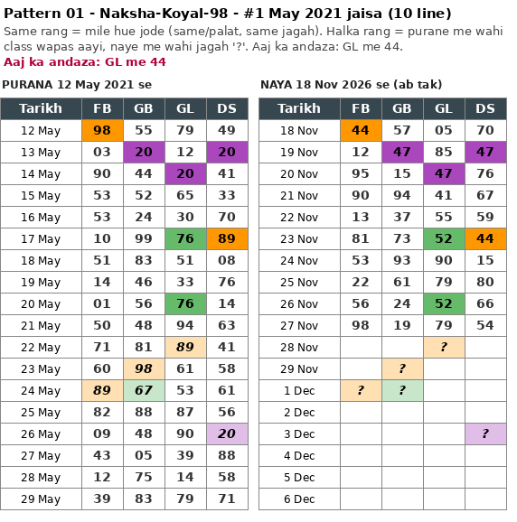
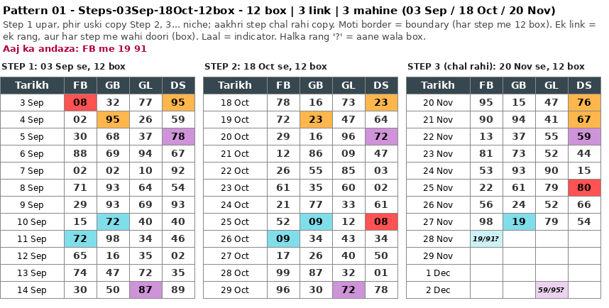
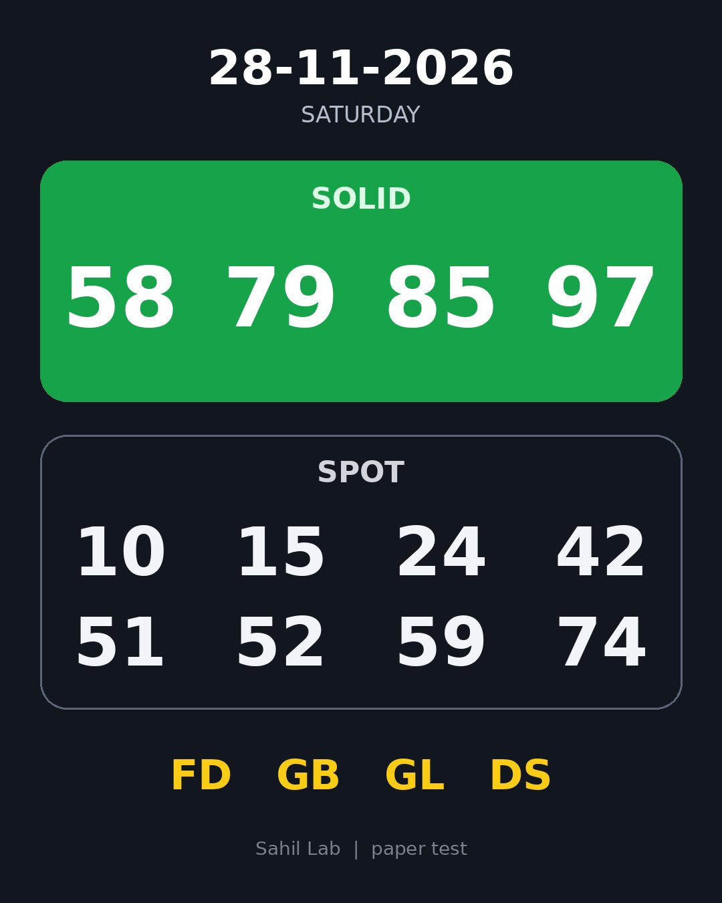

# Sahil Lab: number chart ka puzzle (paper test)

> **Saaf chetavni:** ye **kagaz ka kalpnik puzzle khel** aur R&D hai. Asli paisa lagane ke liye **nahi**, koi salah ya bhavishyavani nahi.
> 13 saal (2013 se) ke data par ab tak ki har jaanch me natija **random jaisa** nikla hai. Koi "pakka number" nahi hota; jo aisa kahe, bharosa mat karo.

## Ye kya karta hai
Har din ke 4 number (FD, GB, GL, DS) ke chart me design dhundhta hai: purane saalon me bana koi naksha aaj phir ban raha hai kya, aur kagaz par (asli paisa nahi) parakhta hai ki wo random se behtar hai ya nahi.

## Dekhiye
**Naksha:** naye din ka rang wala design purane saal me kahan bana tha. Same rang = jude hue jode, '?' = aane wala box.



**Puzzle-Steps (007):** teen mahine ek ke neeche ek, wahi design dobara.



**Roz ka card:**



## Kaise kaam karta hai
1. DS ka result aate hi nayi line judti hai, saare pattern Python code se dobara bante hain (koi AI nahi).
2. Aaj ki jodi ki tokri **result se pehle lock** hoti hai, baad me nahi badalti.
3. Har list ka Rs 10,000 ka **kagaz** pocket chalta hai, saath me ek **Random 30** pocket: koi list usse saaf aage na ho to fayda saabit nahi.
4. Result na aaye to app bada laal box dikhati hai; purane data se aaj ka kuch nahi banta.

Poori baat (har pattern kaise banta hai): [patterns/SAMAJH.md](patterns/SAMAJH.md) | faisle aur wajah: [patterns/HANDOFF.md](patterns/HANDOFF.md) | code ki suchi: [patterns/AUTO_INDEX.md](patterns/AUTO_INDEX.md)

## Apne computer par chalana
```
pip install -r requirements.txt
python -m lab.update --no-fetch              # maujooda data se scan
LAB_SYNC=0 PORT=5000 python lab_server.py    # app: http://127.0.0.1:5000
python -m unittest tests.test_lab tests.test_core tests.test_fetcher tests.test_paper tests.test_server tests.test_mcp tests.test_card
```
Koi key zaroori nahi (help chat aur connector ke bina bhi app chalti hai).

## Kaam karne ke niyam
Pehle [CLAUDE.md](CLAUDE.md) (insaan aur AI dono ke liye): alag branch, test, note, pehredaar, maalik ki haan, tab push.

## Haq (LICENSE)
Abhi **koi open-source LICENSE nahi** diya gaya hai. Code dekhne ke liye khula hai; copy karne, chalane-bechne ya naye roop me baantne ki ijazat maalik se leni hogi. Sab haq surakshit.
